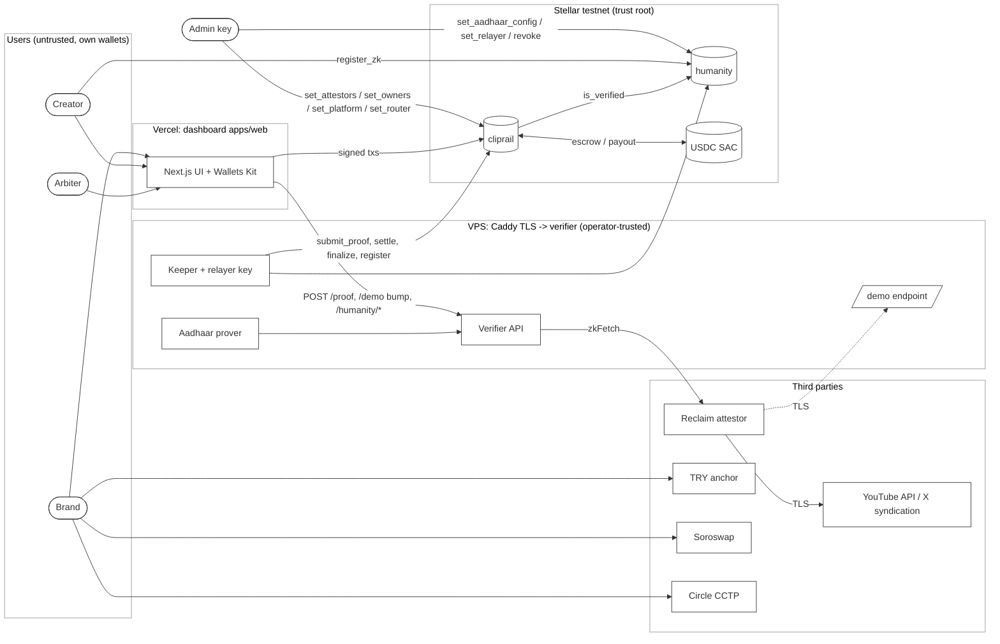

# Cashtag threat model (STRIDE)

Status: working draft, tracking issue #72. This document prepares Cashtag for a future independent security audit (and is written as preparation for a possible SCF Soroban Security Audit Bank application; it makes no eligibility claim). Every mitigation below cites the code that implements it as `path:function`. Findings are open items `TM-n` (section 7); their current status is tracked in [REMEDIATION.md](REMEDIATION.md). Sections 4 and 5 describe the code as first reviewed, so read them alongside that file.

## 1. Scope and assumptions

In scope:

| Component | Code |
| --- | --- |
| `cliprail` escrow contract | `contracts/cliprail/src/{lib,epoch,dispute,proof,storage,types}.rs` |
| `reclaim-verify` library (in-contract zkTLS check) | `contracts/reclaim-verify/src/lib.rs` |
| `humanity` registry (Anon Aadhaar Groth16 + relayer path) | `contracts/humanity/src/{lib,groth16,vk}.rs` |
| Verifier API, keeper, relayer, Anon Aadhaar prover | `services/verifier/src/*.ts` |
| Hosting | `deploy/` (Docker Compose, Caddy TLS, Hetzner VPS) |
| Platform config | `config/providers.json`, `fixtures/required-substrings.json` |
| Dashboard | `apps/web` (Next.js on Vercel), `packages/client` |
| Funding routes | TRY anchor (`packages/client/src/anchor.ts`), Soroswap (`cliprail::create_campaign_with_swap`), CCTP V2 (`scripts/cctp/`) |

Assumptions:

- **Testnet only.** All deployments run on Stellar testnet with Circle testnet USDC. There are no real funds, no real users and no real fiat (the TRY anchor bank leg is simulated). Mainnet is gated on an independent audit and on closing the High items in section 7.
- **Severity** is rated for a hypothetical mainnet deployment of the *current* code and configuration. Today's real-world impact is nil because nothing of value is at stake.
- Soroban host, Stellar consensus, the Circle USDC SAC, Circle CCTP contracts and the Soroswap router are trusted and out of scope (section 6).
- The Reclaim attestor behaves honestly unless stated otherwise (we analyse what happens when it does not).

## 2. System overview

A **brand** escrows a USDC budget in `cliprail` (`create_campaign`, or `create_campaign_with_swap` through Soroswap). A **creator** (clipper) proves personhood in `humanity` (`register_zk`, or the relayer `register` fallback), calls `join` and receives a participant code (`CR-` plus 10 base36 characters), posts content carrying that code, and registers the post with an opening zkTLS proof (`register_clip`). After each epoch a closing proof (`submit_proof`, usually sent by the keeper) records metric growth. Settlement computes `r_eff = min(rate_max_per_1k, 1000 · epoch_budget / W)` (`contracts/cliprail/src/epoch.rs:rate_for`): the rate is a ceiling and over-subscribed epochs are paid pro-rata. Clippers `claim` and later `claim_holdback`; anyone may `challenge` a clip-epoch with a bond; unspent budget is refunded to the brand (`refund`). The metric is views for `youtube` and `demo`, and **likes** (`favorite_count`) for `x`, stored in the same contract slot named `views`.

Trust boundaries are the subgraph borders: user wallet to dashboard, browser to verifier (public HTTPS), verifier to Reclaim and platforms, and every arrow into the chain (the contracts trust only signatures and `require_auth`).

## 3. Assets

| ID | Asset | Where it lives | Why it matters |
| --- | --- | --- | --- |
| A1 | Escrowed USDC (campaign `balance`, dispute bonds) | `cliprail` contract balance | Direct loss of funds |
| A2 | `cliprail` admin key | Stellar account (testnet CLI identity) | Controls attestor/owner allow-lists, platform URLs/regexes, router for *all* campaigns |
| A3 | `humanity` admin key | Stellar account | Controls UIDAI key hash, relayer, revocation |
| A4 | Relayer key (`RELAYER_SECRET`) | `deploy/verifier.env` on the VPS | Humanity `register` authority (mint humans) and keeper fee payer |
| A5 | Attestor allow-list (`DataKey::Attestors`) | `cliprail` instance storage | Any listed key can sign arbitrary metrics |
| A6 | Owner allow-list and `RECLAIM_APP_SECRET` (owner key) | Instance storage / VPS env | Only proofs owned by listed keys are accepted |
| A7 | Platform configs (`PlatformConfig`: URL prefix/suffix, `required`) | Instance storage | Define what a valid proof is |
| A8 | Nullifier and wallet maps | `humanity` persistent storage | Sybil resistance |
| A9 | `WRITE_TOKEN` | VPS env and (today) the dashboard bundle | Gates demo bump, demo humanity registration, prover, close-proof submission |
| A10 | `YT_API_KEY`, Reclaim quota | VPS env | Cost and availability |
| A11 | Participant codes `CR-XXXXXX` | Public on-chain (`join` event) | Bind a post to a wallet |
| A12 | Simulated attestor/owner secrets | `services/verifier/src/simulated.ts` defaults (public) | Any instance trusting them is forgeable |
| A13 | Anon Aadhaar TEST private key | `fixtures/aadhaar/testPrivateKey.pem` (public) | Mints test identities |
| A14 | Creator privacy (Aadhaar revealed fields, wallet linkage) | On-chain events, prover logs | Personal data exposure |
| A15 | Service availability (keeper, prover, `/proof`) | VPS | Missed proof windows mean zero weight |

## 4. Trust boundaries and actors

| Actor | Trust level | Can do | Must not be able to |
| --- | --- | --- | --- |
| Brand | Untrusted | Create and fund a campaign, choose all params (including arbiter and token), challenge clips, refund after `refund_at` | Withdraw escrow early, change rules after creation |
| Creator / clipper | Untrusted | Register humanity, join, register clips, respond, claim | Claim another person's reach, farm with many wallets, exceed caps |
| Challenger | Untrusted (anyone) | Post a bond and challenge a clip-epoch | Exclude clips at no cost |
| Arbiter | Semi-trusted, chosen per campaign by the brand | `resolve` responded disputes inside `[dispute_end, settle_at)` | Touch funds directly |
| Keeper / relayer (our service) | Operator-trusted for liveness | Submit close proofs, settle, finalize (all permissionless), call `humanity.register` | Change numbers or move funds (it can, however, mint humans via `register`) |
| Admin (us) | Fully trusted today | Reconfigure attestors, owners, platforms, router, UIDAI key, relayer | (Intended) affect live campaigns; today it can |
| Reclaim attestor | Trusted third party (single key, TEE) | Sign claims over TLS transcripts | Sign false metrics |
| Platform APIs (YouTube, X syndication, our `/demo`) | Trusted data source | Serve the metric and caption | (Out of our control) serve inflated numbers |
| TRY anchor, Soroswap, Circle CCTP | Trusted third parties | Fiat ramp, swap, bridge | |
| Attacker | Remote, unauthenticated, may hold many wallets and testnet funds | Call any public contract function and any public HTTP route | |

## 5. STRIDE analysis

Columns: **T**hreat (STRIDE letter), existing **mitigation**, **residual** risk, **sev**erity (High/Medium/Low, rated for mainnet), proposed **action** (open item).

### 5.1 `cliprail` escrow contract

| # | Threat | Mitigation | Residual | Sev | Action |
| --- | --- | --- | --- | --- | --- |
| C1 | S: forged metric proof | Signature recovery + attestor and owner allow-lists, exact URL, `required` substrings, code in caption (`reclaim-verify/src/lib.rs:verify`, `cliprail/src/proof.rs:verify_and_consume`) | Trust rests on one attestor key and on whoever holds an allowed owner key (C3) | Medium | TM-9 |
| C2 | T: admin reconfigures a live campaign (adds an attestor, repoints a platform URL to a host it controls, swaps router) | `require_auth` on admin setters (`lib.rs:set_attestors`, `set_owners`, `set_platform`, `set_router`); constructor-only init (`lib.rs:__constructor`) | Campaign params are immutable, but global config read at proof time is not: a compromised or malicious admin can mint arbitrary weight in every live campaign and drain budgets up to the caps. No multisig, timelock, or admin rotation | High | TM-1 |
| C3 | T: allowed owner adds extra `responseMatches` (for example a second `views` capture) or redactions | `required` entries must appear in `parameters.responseMatches` (`reclaim-verify/src/lib.rs:verify` step 3) | Check is substring presence, not equality of the whole array; `method`, `body`, `headers`, `responseRedactions` are not pinned. Exploitable by anyone holding `RECLAIM_APP_SECRET` (or the public simulated owner key) | Medium | TM-8 |
| C4 | S: front-run another creator's post by grinding a wallet whose participant code collides with theirs | Codes are per campaign and per wallet (`lib.rs:participant_code`); one registration per video (`DataKey::VideoIndex`) | Code space is 36^6 (about 2^31): a matching wallet can be ground offline in hours, then `register_clip` the victim's post first and collect its payouts. Humanity gate is weak while TM-4 is open | High | TM-7 |
| C5 | R/T: proof replay | Replay key `keccak(identifier ‖ timestamp_s)` stored as `UsedProof` (`proof.rs:verify_and_consume`); opening proof age 600 s and future skew 600 s (`lib.rs:register_clip`); close proof must postdate `content_end - 60 s` (`lib.rs:submit_proof`) | Opening baseline may be up to 10 min stale (slightly lower baseline) | Low | none |
| C6 | T: close proof lowers weight or is submitted by a third party | `submit_proof` is permissionless but only raises `ce.views` (monotone max) (`lib.rs:submit_proof`) | None found | Low | none |
| C7 | E: brand-controlled arbiter + challenges zero all weight and recover the budget | Bond required (`epoch.rs:validate_params`: `bond > 0`, `arbiter != brand`); arbiter only rules on responded disputes, silent arbiter loses (`dispute.rs:resolve`, `finalize`) | `arbiter != brand` is an address check only (a second brand wallet passes). Winning challenger gets the bond back, so challenges are free for an honest-looking brand. If all weight is excluded, `spent = 0`, the budget carries forward and returns to the brand (`epoch.rs:compute_settlement`, `lib.rs:refund`) | High | TM-6 |
| C8 | D: griefing inattentive creators | Response window up to `dispute_end` (`dispute.rs:respond`) | Unanswered challenge excludes the clip-epoch and refunds the bond (`dispute.rs:finalize`); there is no notification channel and windows can be short | Medium | TM-6 |
| C9 | T: payout arithmetic overflow or over-payment | Param bounds (`epoch.rs:validate_params`, `MAX_*`), holdback rounded up (`epoch.rs:held_of`), payouts clamped to campaign balance (`lib.rs:pay_out`), ordered settlement (`lib.rs:settle`) | Rounding dust returns to brand. Needs independent arithmetic review and property tests | Low | TM-20 |
| C10 | D: unbounded per-campaign lists | Size limits on title, URL, evidence, video id (`epoch.rs`, `dispute.rs:MAX_EVIDENCE`, `proof.rs:validate_video_id`) | `CampaignClips`/`CampaignDisputes` vectors grow without bound (`storage.rs:push_id`), `get_clips` is unpaginated (comment in `lib.rs:get_clips`); the keeper depends on it | Medium | TM-14 |
| C11 | S: fake or hostile campaign token | Brand chooses `params.token`; SAC semantics assumed | Any SEP-41 contract is accepted; a look-alike token can mislead creators. Soroban forbids re-entry, limiting damage to that campaign | Low | TM-17 |
| C12 | T: swap funding manipulation | Path endpoints checked, `amount_in_max` bound, balance delta must cover the budget (`lib.rs:create_campaign_with_swap`) | Router is admin-set (C2); slippage chosen by the brand | Low | TM-1 |
| C13 | D: state archival / no upgrade path | TTL bumps on reads and writes (`storage.rs:put`, `get_live`, 30 days) | Long idle campaigns need restore. No upgrade function and no admin rotation: a bug or a lost admin key cannot be fixed in place | Low | TM-19 |
| C14 | I: public metadata | Only addresses, codes, metrics on-chain | Codes link a wallet to social accounts publicly (inherent to the design) | Low | section 6 |

### 5.2 `reclaim-verify` library

| # | Threat | Mitigation | Residual | Sev | Action |
| --- | --- | --- | --- | --- | --- |
| V1 | T: JSON confusion (nested `url`, duplicate keys, escapes) | Root-level key lookup, duplicates fail closed, escape-aware scanner (`lib.rs:field`, `json_str`, `skip_value`) | Hand-written parser; needs fuzzing against attestor-core canonical output | Medium | TM-20 |
| V2 | D: host trap on malformed signature | `recovery_id <= 1`, `1 <= r < n`, low-s check before recovery (`lib.rs:sig_in_range`) | Unrecoverable `r` still traps (documented in `verify`); a trap only fails the caller's own tx | Low | none |
| V3 | T: oversized input | `MAX_JSON = 8192`, `MAX_SMALL = 1024`, owner <= 64 bytes (`lib.rs:copy`) | None found | Low | none |
| V4 | S: Reclaim `epoch` and witness set ignored | Single signature against an allow-list | No threshold of attestors, Reclaim epoch not checked | Medium | TM-9 |

### 5.3 `humanity` registry

| # | Threat | Mitigation | Residual | Sev | Action |
| --- | --- | --- | --- | --- | --- |
| H1 | S: Sybil via the TEST UIDAI key | Groth16 verified on-chain against pinned `pubkey_hash`, nullifier seed bound to campaign, signal bound to wallet ed25519 key (`lib.rs:register_zk`, `groth16.rs:verify`, `nullifier_seed`, `signal_hash`) | Demo config pins the Anon Aadhaar **test** key, whose private key is public (`fixtures/aadhaar/testPrivateKey.pem`): anyone can mint unlimited identities. `test_key` is informational only | High | TM-4 |
| H2 | E: relayer mints humans | `register` requires relayer auth (`lib.rs:register`) | Relayer is a hot key on the VPS (A4). With `DEMO_MODE=1` the verifier registers any wallet with a per-wallet nullifier (`ops.ts:demoNullifier`, `demoRegister`), so there is no Sybil resistance on that path | High | TM-3, TM-15 |
| H3 | T: admin swaps UIDAI key or relayer | `admin.require_auth` (`lib.rs:set_aadhaar_config`, `set_relayer`) | No multisig, timelock or admin rotation; config change applies to all campaigns | High | TM-1 |
| H4 | T: aliased public inputs | Inputs `>= r` rejected (`groth16.rs:verify`) | Point validation of `a`, `b`, `c` relies on BN254 host functions; to confirm in audit | Medium | TM-20 |
| H5 | R: revocation is not propagated | `revoke` deletes the wallet entry, nullifier stays used (`lib.rs:revoke`) | `cliprail` checks `is_verified` only at `join` (`cliprail/src/lib.rs:join`); a revoked participant keeps earning | Low | TM-21 |
| H6 | I: revealed Aadhaar fields | Client chooses `age_above_18`, `gender`, `pin_code`, `state` values | Revealed values are passed in public tx args; production UI must default to not revealing | Low | TM-21 |
| H7 | T: stale QR | `max_age` and 1 h future skew (`lib.rs:check_aadhaar`) | None found | Low | none |

### 5.4 Verifier API (`services/verifier/src/app.ts`)

| # | Threat | Mitigation | Residual | Sev | Action |
| --- | --- | --- | --- | --- | --- |
| A-1 | S/E: unauthenticated writes | Bearer `WRITE_TOKEN`, constant-time compare (`app.ts:requireToken`) on `/proof/submit`, `/demo/videos/:id/bump`, `/humanity/demo-register`, `/humanity/aadhaar/prove` | **Fails open** when `WRITE_TOKEN` is empty (default in `deploy/verifier.env.example`), and the dashboard ships the token to every browser as `NEXT_PUBLIC_WRITE_TOKEN` (`apps/web/src/lib/api/config.ts`, `lib/api/demo.ts:bumpDemoVideo`). Effectively anyone can bump demo counts and register humans | High | TM-2 |
| A-2 | D: proof quota exhaustion via `POST /proof` | Token bucket 5/min per IP (`limit.ts:TokenBucket`, `app.ts:PROOF_RATE`), 120 s proof reuse, in-flight dedupe and 2 concurrent zkFetch (`zkfetch.ts:ProofService.get`) | Client IP is the first `X-Forwarded-For` hop, trusted unconditionally (`app.ts:clientIp`); safe only while Caddy is the sole ingress. Bucket map is wiped at 10 000 keys (global reset by IP rotation); state is per process | Medium | TM-12 |
| A-3 | T: input injection into proof URL | Per-platform video id regex (`zkfetch.ts:VIDEO_ID_RE`), mirrored on-chain (`proof.rs:validate_video_id`); claim URL and attestor rechecked (`zkfetch.ts:fresh`) | None found | Low | none |
| A-4 | I: error detail leakage | `/health` returns fixed codes; chain errors truncated (`chain.ts:chainError`) | Generic handler returns raw `message` on 500 (`app.ts:onError`); CORS defaults to `*` (`config.ts:corsOrigin`) | Low | TM-18 |
| A-5 | T: demo platform is operator-controlled | Bump bounds (`demo.ts:bump`), write token | The `demo` endpoint serves numbers we set; a real Reclaim proof over it attests only that our server said so. Any campaign allowing `demo` fully trusts the operator (and, while A-1 is open, anyone) | High | TM-10 |

### 5.5 Keeper and relayer (`keeper.ts`, `ops.ts`, `chain.ts`)

| # | Threat | Mitigation | Residual | Sev | Action |
| --- | --- | --- | --- | --- | --- |
| K1 | D: missed close-proof window means zero weight; budget flows back to the brand | Keeper per-tick schedule (`keeper.ts:tick`, `campaign`), precheck mirrors contract (`ops.ts:closePrecheck`), retry/refetch sets, `MAX_FETCHES = 2` | Single process; only proofs owned by our owner key are accepted on-chain, so in practice our service is the sole close-proof producer (creators can call `/proof` and submit themselves, but the dashboard has no such path). Censorship and downtime both hurt creators | Medium | TM-11 |
| K2 | E: relayer key compromise | Settle/finalize/submit are permissionless, so the key holds no fund authority in `cliprail` | Same key is the `humanity` relayer (H2) and pays fees; stored as plain env on one VPS (`deploy/verifier.env.example`, `config.ts:relayerSecret`) | High | TM-15 |
| K3 | D: campaign spam slows the keeper | Per-key busy set (`keeper.ts:act`) | Keeper reads every campaign ever created each tick (`keeper.ts:tick`); campaigns with dust budgets are cheap | Low | TM-14 |
| K4 | T: sequence-number races | Serialized build/sign/send with bad-seq retry (`chain.ts`) | None found | Low | none |

### 5.6 Anon Aadhaar prover (`aadhaar.ts`)

| # | Threat | Mitigation | Residual | Sev | Action |
| --- | --- | --- | --- | --- | --- |
| P1 | S: unlimited identities | TEST mode only; `identity` restricted to `[A-Za-z0-9_-]{1,64}` (`aadhaar.ts:AadhaarProver.prove`) | Caller picks `identity`, so each call can be a new "person" (by design for the demo) | High | TM-4 |
| P2 | D: memory and CPU exhaustion | Single-flight queue, 10 min cache, 120 s timeout (`aadhaar.ts:enqueue`, `prove`) | About 3.7 GB per job and the queue is unbounded; reachable by anyone while A-1 is open | Medium | TM-13 |
| P3 | I: identity data on the server | Demo uses UIDAI test data only | Production design proves in the browser; server-side proving must not ship to production | Medium | TM-4 |

### 5.7 Attestor modes (`zkfetch.ts`, `simulated.ts`)

| # | Threat | Mitigation | Residual | Sev | Action |
| --- | --- | --- | --- | --- | --- |
| M1 | S: forged proofs in `simulated` mode | Separate cache, startup warning (`index.ts`), `/health` reports `attestorMode` (`app.ts`) | Default simulated secrets are derived from public strings (`simulated.ts:DEFAULT_SIM_ATTESTOR_SECRET`) and used silently when `SIM_ATTESTOR_SECRET` is unset (`config.ts`). Any contract that allow-lists that address accepts forged proofs from anyone | High | TM-5 |
| M2 | S: Reclaim attestor compromise or key change | Allow-list (`RECLAIM_ATTESTORS`, `set_attestors`), off-chain attestor check before caching (`zkfetch.ts:fresh`), attestor runs in a TEE | Single key; a key rotation by Reclaim halts verification until the admin updates the list | Medium | TM-9 |
| M3 | T: wrong field extracted on `x` | Regex pinned on-chain via `required` | First-match regexes on `favorite_count` and `"id_str":…,"text"` may bind to a nested quoted or parent tweet in the syndication JSON (to verify). The endpoint is unofficial (`token=a`) and may change | Medium | TM-8, TM-16 |
| M4 | R: likes reported as views | Provider `metric: "likes"` (`config/providers.json`), README states it | The contract slot is named `views` and stores no metric label; rates copied from views campaigns overpay by orders of magnitude | Medium | TM-16 |

### 5.8 Dashboard (`apps/web`)

| # | Threat | Mitigation | Residual | Sev | Action |
| --- | --- | --- | --- | --- | --- |
| W1 | I: secret in client bundle | none | `NEXT_PUBLIC_WRITE_TOKEN` (see A-1) | High | TM-2 |
| W2 | T: stored XSS via on-chain strings | React escaping; React 19 blocks `javascript:` URLs; form validates `http(s)://` (`lib/campaignForm.ts`) | `brief_url` from chain is rendered as `href` without a render-time scheme check (`components/campaign/CampaignPage.tsx`); a brand can bypass the form | Low | TM-21 |
| W3 | S: tx tampering | Users sign in their own wallet via Stellar Wallets Kit; every tx linked to stellar.expert | Users must read wallet prompts; no tx summary signing | Low | none |

### 5.9 Funding routes

| # | Threat | Mitigation | Residual | Sev | Action |
| --- | --- | --- | --- | --- | --- |
| F1 | S: fake anchor / SEP-10 challenge | SEP-1 `SIGNING_KEY` from `stellar.toml`, `WebAuth.readChallengeTx` with home and web-auth domains (`packages/client/src/anchor.ts`) | Anchor is a sandbox; bank leg simulated; anchor solvency out of scope | Low | section 6 |
| F2 | T: CCTP funds stranded | `mintRecipient` and `destinationCaller` fixed to CctpForwarder, hookData layout unit-tested and re-parsed before burn (`scripts/cctp/bridge.ts`, `scripts/cctp/README.md`) | Operator CLI only; EVM key in a gitignored file | Low | none |
| F3 | T: swap slippage | See C12 | | Low | TM-1 |

### 5.10 Hosting (`deploy/`)

| # | Threat | Mitigation | Residual | Sev | Action |
| --- | --- | --- | --- | --- | --- |
| D1 | I/E: host compromise exposes A4, A6, A9, A10 | Only Caddy publishes ports (80/443); verifier port is internal (`deploy/docker-compose.yml`); env files excluded from rsync (`deploy/deploy.sh`) | Secrets live as plaintext env on one VPS and are visible via `docker inspect`; no documented SSH/firewall hardening, rotation or monitoring | Medium | TM-15 |
| D2 | D: single host | `restart: unless-stopped`, health check | No redundancy or alerting | Medium | TM-11 |

## 6. Out of scope and known limitations

- Soroban host functions (secp256k1 recovery, BN254 pairing, keccak), Stellar consensus, the USDC SAC, Circle CCTP and Iris, Soroswap contracts, and Reclaim's TEE are trusted.
- **Fake engagement.** zkTLS proves the number the platform served, not that the audience is real. Bought views or likes are mitigated only economically (per-clip and per-human caps, rate ceiling, disputes). Likes on `x` are cheaper to buy than views.
- **Content quality and brand fit** are judged through disputes, not code; the contract checks only that the code is in the caption.
- **Identity renting.** Even with the real UIDAI key, a person can lend their identity; Aadhaar covers India only.
- **Device-side proofs** (TikTok, Instagram, X views) are not shipped and not analysed here.
- **Anchor** is a sandbox (`tr-mock-anchor.fly.dev`); licensing, KYC data handling and fiat settlement are out of scope.
- Public linkage of wallets to social accounts via participant codes is inherent to the design.
- Economic game theory of bonds and windows beyond the issues listed (C7, C8) is deferred to the audit.

## 7. Open items

Priority follows the highest severity of the linked threats. "Before mainnet" items are blocking.

| ID | Sev | Item | Links | Proposed remediation |
| --- | --- | --- | --- | --- |
| TM-1 | High | Centralised mutable admin on both contracts affects live campaigns | C2, C12, H3 | Admin as a Stellar multisig account, timelock on setters, snapshot attestors/owners/platform config into each campaign at creation, add two-step admin transfer |
| TM-2 | High | `WRITE_TOKEN` fails open and is shipped to browsers | A-1, W1 | Refuse to start without a token outside dev; move privileged calls behind a server route or per-wallet SEP-10 style auth; delete `NEXT_PUBLIC_WRITE_TOKEN` |
| TM-3 | High | Relayer `register` and `DEMO_MODE` give no Sybil resistance | H2 | `DEMO_MODE=0` on hosted stacks; retire the relayer path before mainnet (remove `register` or `set_relayer` to a disabled key) |
| TM-4 | High | TEST UIDAI key and server-side prover with free `identity` | H1, P1, P3 | Pin the production UIDAI key hash; make `test_key = true` impossible in a mainnet build; prove in the browser; drop `/humanity/aadhaar/prove` from production |
| TM-5 | High | Simulated attestor default keys are public and used silently | M1 | Require an explicit secret and refuse non-local binding in `simulated` mode; deploy scripts assert the simulated address is not allow-listed on non-rehearsal instances |
| TM-6 | High | Brand-chosen arbiter and free challenges can zero weight and refund the brand; inattentive creators lose by default | C7, C8 | Arbiter from a curated neutral set; excluded weight must not return to the brand; partial bond forfeiture or fee even when the challenger wins; minimum response window; creator notifications |
| TM-7 | High | 31-bit participant code is grindable, enabling post theft by front-running `register_clip` | C4 | Lengthen the code to at least 64 bits, or bind the post to the wallet with a second factor (for example a per-participant secret suffix) |
| TM-8 | Medium | `required` is substring presence; extra matches and unpinned request fields; X regex may hit nested tweets | C3, M3 | Pin the exact `responseMatches` array and `method`/`body`/`headers`/`responseRedactions`; test against quoted and reply tweets; anchor regexes |
| TM-9 | Medium | Single Reclaim attestor and single owner key | C1, V4, M2 | Threshold of attestors, check Reclaim epoch, owner key rotation runbook, alert on unknown-attestor rejections |
| TM-10 | High | `demo` platform is operator-controlled | A-5 | Never `set_platform("demo")` on mainnet; label demo campaigns in the UI; keep the endpoint testnet-only |
| TM-11 | Medium | Close-proof liveness depends on one keeper and our owner key | K1, D2 | Dashboard path for creators to fetch and submit their own close proof; second keeper; uptime alerts; generous proof windows |
| TM-12 | Medium | Weak `/proof` rate limiting | A-2 | Trust `X-Forwarded-For` only from Caddy; rate limit at Caddy; LRU instead of wipe; global zkFetch budget |
| TM-13 | Medium | Prover resource exhaustion | P2 | Bounded queue, per-IP limit, container memory limit, separate host |
| TM-14 | Medium | Unbounded clip and dispute lists, unpaginated reads, keeper scans all campaigns | C10, K3 | Paginate `get_clips`/`list_disputes`, per-campaign caps, minimum budget, event-driven keeper index |
| TM-15 | High | Relayer and owner secrets as plaintext env on a single VPS; one key for two roles | K2, D1 | Split keys (fee-only keeper key), secrets manager or file permissions, minimal relayer balance, SSH and firewall hardening, rotation runbook |
| TM-16 | Medium | Likes vs views; fake engagement | M3, M4 | Store a metric label in `PlatformConfig` and campaign; per-platform rate guidance in the UI; off-chain anomaly signals feeding disputes |
| TM-17 | Low | Campaign token not allow-listed | C11 | Token allow-list (USDC SAC) or prominent UI warning |
| TM-18 | Low | Error message disclosure and `CORS_ORIGIN=*` | A-4 | Generic 500 bodies; explicit CORS origins in `deploy/verifier.env` |
| TM-19 | Low | No upgrade or migration policy; 30-day TTL | C13 | Decide immutable-plus-migration vs timelocked upgrade; TTL bump strategy for long campaigns |
| TM-20 | Medium | Hand-written JSON parser, BN254 point validation, payout arithmetic need independent assurance | V1, H4, C9 | Fuzz `reclaim-verify` against attestor-core output; property tests for settlement invariants (sum of payouts <= budget); audit focus list |
| TM-21 | Low | Defence in depth: revocation propagation, Aadhaar field disclosure, `brief_url` rendering | H5, H6, W2 | Re-check `is_verified` at claim or registration; default to no revealed fields; render-time `https:` check |
